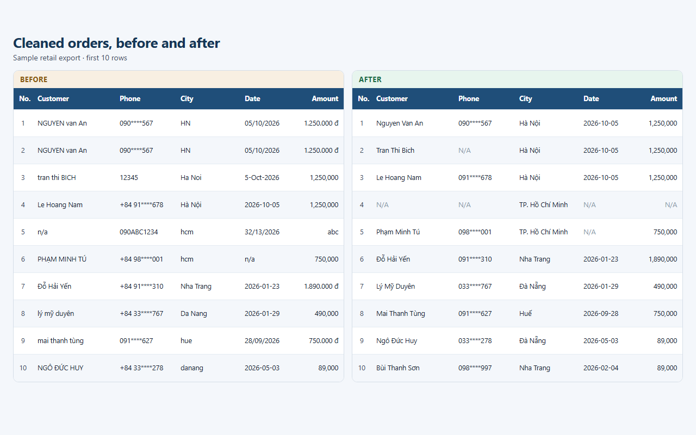

# Data Cleaning Toolkit

A small Python project that turns a messy Vietnamese retail export into one clean table, a formatted Excel file, and a short report of what changed.



## Problem

Orders from several stores land in one spreadsheet. Staff type the same facts in different ways:

- names in mixed case, with extra spaces (`  NGUYEN  van   An `)
- dates as `2026-10-05`, `05/10/2026`, or `5-Oct-2026`
- money as `1.250.000 đ`, `1,250,000`, or `1250000`
- cities as `HN`, `Ha Noi`, or `Hà Nội`
- phone numbers with spaces, dashes, or a `+84` country code
- broken emails, placeholder text such as `n/a` and `-`, and the same row pasted twice

The cleaned file is safe to open in Excel or load into a report. Invalid emails, phones, dates, and amounts are cleared and listed. The rest of the row stays.

## Features

- Trim extra spaces
- Normalize name and product case (`NGUYEN VAN AN` becomes `Nguyen Van An`)
- Parse the three date formats above into `YYYY-MM-DD` (slash dates are day/month/year)
- Parse VND amounts into whole numbers of dong
- Validate emails and Vietnamese mobile numbers
- Map city aliases onto one standard name
- Replace missing markers (`n/a`, `null`, `none`, `-`) with empty cells
- Drop exact duplicate rows after cleaning, so copies that only differed by spaces are removed too
- Write `cleaned.csv`, a formatted `cleaned.xlsx` (bold header, filter, frozen header row, fitted column widths), and `report.md`

The cleaning steps live in `cleaner.py` as small functions with docstrings. You can try one cell at a time:

```python
from cleaner import parse_vnd_amount, parse_date, map_city_name

parse_vnd_amount("1.250.000 đ")  # 1250000
parse_date("05/10/2026")         # "2026-10-05"
map_city_name("HN")              # "Hà Nội"
```

## Before and after

`DH0001` in the sample file:

| Column | Before | After |
| --- | --- | --- |
| customer_name | `  NGUYEN  van   An ` | Nguyen Van An |
| email | `An.Nguyen@Gmail.com ` | an.nguyen@gmail.com |
| phone | `090 123 4567` | 0901234567 |
| city | HN | Hà Nội |
| order_date | 05/10/2026 | 2026-10-05 |
| product | `  ao thun  ` | Ao Thun |
| amount | `1.250.000 đ` | 1250000 |

The next row in the raw file is an exact copy of `DH0001`, so it is removed.

Other shapes from the same file:

| Column | Before | After |
| --- | --- | --- |
| customer_name | tran thi BICH | Tran Thi Bich |
| email | tran..bich@gmail.com | empty (invalid) |
| phone | +84 91 234 5678 | 0912345678 |
| phone | 12345 | empty (invalid) |
| city | Ha Noi | Hà Nội |
| city | hcm | TP. Hồ Chí Minh |
| order_date | 5-Oct-2026 | 2026-10-05 |
| order_date | 2026-10-05 | 2026-10-05 |
| amount | 1,250,000 | 1250000 |
| amount | 1250000 | 1250000 |
| amount | abc | empty (invalid) |

A second run on the cleaned file does not change it again.

## Sample run

`make_sample.py` writes 300 messy orders (seed 42). Cleaning that file produces:

| | |
| --- | ---: |
| Rows before | 300 |
| Rows after | 250 |
| Duplicate rows removed | 50 |
| Invalid values cleared | 68 |
| Rows with an invalid value | 58 |
| Unrecognized cities kept for review | 9 |

`sample_output/` is that run, already saved, so you can open the Excel file and the report without executing anything. `output/` is gitignored and is where a new run writes.

## How to run

From this folder, on Windows PowerShell:

```powershell
python -m venv .venv
.\.venv\Scripts\Activate.ps1
pip install -r requirements.txt

python make_sample.py
python main.py sample_input\customers_messy.csv
```

That writes:

- `output\cleaned.csv` (UTF-8 with BOM, so Excel shows Vietnamese correctly)
- `output\cleaned.xlsx`
- `output\report.md`

Clean your own file the same way. The CSV needs these columns: `order_id`, `customer_name`, `email`, `phone`, `city`, `order_date`, `product`, `amount`.

```powershell
python main.py path\to\orders.csv --output-dir output
```

## Project layout

| File | Role |
| --- | --- |
| `cleaner.py` | Reusable cleaning functions and `clean_orders()` |
| `main.py` | Command-line tool that writes the CSV, Excel file, and report |
| `make_sample.py` | Builds `sample_input/customers_messy.csv` |
| `sample_input/` | The messy demo file |
| `sample_output/` | One finished run of the demo |
| `requirements.txt` | `pandas` and `openpyxl` |

## Notes

- The tool does not guess missing Vietnamese accents. `NGUYEN VAN AN` stays `Nguyen Van An`.
- It does not invent a price or a date. Unreadable values become empty and are listed in the report.
- A bad email or phone does not delete the order.
- City spellings that are not in the list (for example `Da Lat`) are title-cased and kept. Add a line to `CITY_ALIASES` in `cleaner.py` when a store uses a new spelling.
